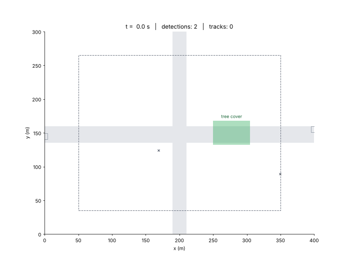

# Kalman Drone Tracker

[](https://github.com/Thirumoorthi-360/kalman-drone-tracker/actions/workflows/ci.yml)


**Multi-target vehicle tracking from a surveillance drone, built on Kalman filters in modern C++ with zero dependencies.**

A simulated drone hovers over a crossroads. Its vehicle detector is noisy, misses vehicles, reports false alarms, and is blind under a patch of trees. This project turns that stream of unlabelled dots into clean, stable, labelled tracks.



*Solid squares: tracks updated by a detection. Hollow squares with dashed ellipses: tracks coasting on prediction alone. Ellipses are the 2σ uncertainty from each Kalman filter's covariance P. Watch track #1 coast under the trees, its ellipse swelling, then snap back when the car reappears.*

## Highlights

- **Templated Kalman filter** `KalmanFilter<N, M>`, where every line maps one-to-one to the textbook equations
- **Compile-time-checked matrix library**: multiplying a 4×2 by a 4×4 is a compile error, not a runtime crash
- **Multi-target tracker**: Mahalanobis gating, Hungarian assignment, matching cascade, track confirmation and deletion
- **Realistic simulation**: five vehicles that brake, stop, turn and overtake, plus false alarms, missed detections, occlusion and a drifting camera
- **Honest evaluation**: coverage, RMSE, ID switches, false tracks and track precision against ground truth
- **No dependencies**: just a C++17 compiler and CMake. Python is only used for optional plotting
- Unit tests, GitHub Actions CI set up for Linux, macOS and Windows, and clean under AddressSanitizer/UBSan

## Quick start

```bash
git clone https://github.com/Thirumoorthi-360/kalman-drone-tracker.git
cd kalman-drone-tracker
cmake -S . -B build
cmake --build build --config Release
ctest --test-dir build -C Release        # run the tests
./build/drone_tracker                    # run the demo (Windows: build\Release\drone_tracker.exe)
```

Plot the results (needs `numpy`, `matplotlib`, and `pillow` for the GIF):

```bash
python scripts/plot_tracks.py output --animate   # writes output/tracks.png and output/tracking.gif
```

### Example output

```
ID timeline  ('.' out of view, '-' untracked, '*' under trees & untracked, 1-9/A-Z = track ID)
Car A               ..............--2222222222222222222222222222222222222222222........
Car B               .......---1111111111111111111111111111111111111111111111111111111111111111111....
Car C (turns)             .....................--4444444444444444444444444444444444444444444444444444......
Truck D (stops)                         ..........--555555555555555555555555555555555555555555555555555555555555555555555555555555..........
Car E (overtakes)             ............--33333333333333333333333333333333....

Vehicle               Coverage   RMSE (m)  ID switches
------------------------------------------------------
Car A                      96%       1.61            0
Car B                      96%       1.94            0
Car C (turns)              96%       1.50            0
Truck D (stops)            98%       1.82            0
Car E (overtakes)          94%       2.30            0
------------------------------------------------------
Position error  raw detector: 2.20 m  |  tracker (visible): 1.77 m  |  tracker coasting under trees: 2.25 m
Track precision: 100.0% of displayed tracks are on a real vehicle  |  False tracks: 0  |  Total ID switches: 0
```

Every vehicle keeps a single ID for its whole journey, including through the trees, where there are no detections at all, and despite 191 false alarms.

### Try harder conditions

```bash
./build/drone_tracker --clutter 8 --seed 3            # lots of false alarms
./build/drone_tracker --pdetect 0.6                   # detector misses 40% of the time
./build/drone_tracker --accel-sigma 0.1               # filter too stiff: watch the turning car
./build/drone_tracker --max-coast 3                   # tracks die under the trees and return with new IDs
./build/drone_tracker --help                          # all options
```

There is also a minimal single-target example that prints the filter's internals step by step:

```bash
./build/gps_car_1d
```
```
   k     GPS z |  pred pos  pred sd |  K_pos  K_vel |   est pos  est vel   est sd | true pos true vel
   0      10.8 |       0.0    31.62 |  0.940  0.470 |      10.2     5.10     7.76 |     10.3    10.56
   1      21.5 |      15.3    19.64 |  0.858  0.657 |      20.6     9.18     7.41 |     20.9    10.71
   ...

GPS RMSE:    7.57 m
Kalman RMSE: 4.44 m  (41% better)
Steady-state gain: K_pos = 0.297, K_vel = 0.052
```

## How it works

### The Kalman filter (one per vehicle)

State **x** = [pₓ, p_y, vₓ, v_y]ᵀ with a constant-velocity model. The drone measures position only, so velocity is inferred.

| Step | Equation | Code (`include/kftrack/kalman_filter.hpp`) |
|---|---|---|
| Predict state | x̂⁻ = F x̂ | `x = F * x;` |
| Predict covariance | P⁻ = F P Fᵀ + Q | `P = F * P * F.transpose() + Q;` |
| Innovation | ν = z − H x̂⁻ | `z - H * x` |
| Innovation covariance | S = H P⁻ Hᵀ + R | `H * P * H.transpose() + R` |
| Kalman gain | K = P⁻ Hᵀ S⁻¹ | `P * H.transpose() * inverse(S)` |
| Update state | x̂ = x̂⁻ + K ν | `x = x + K * innovation(z);` |
| Update covariance | P = (I − K H) P⁻ | `P = (StateMatrix::Identity() - K * H) * P;` |

The process noise comes from a random-acceleration model, Q = G Gᵀ σₐ² with G = [Δt²/2, Δt]ᵀ per axis (`src/tracker.cpp`).

### The tracker (every frame)

1. **Predict** every track forward one frame.
2. **Gate**: a detection may only join a track if its Mahalanobis distance d² = νᵀS⁻¹ν is below 9.21 (the 99% χ² threshold, 2 degrees of freedom). The gate widens automatically as a track grows uncertain.
3. **Assign** detections with the Hungarian algorithm, as a **matching cascade**: tracks seen last frame choose first, then longer-coasting tracks, then tentative ones.
4. **Update** matched tracks with the Kalman equations. Unmatched tracks **coast**.
5. **Manage**: a new detection starts a tentative track; 3 hits confirm it; tracks are deleted after too long coasting, once too uncertain, or when they leave the camera view.

### Design decisions, with measured results

Each change below fixed a failure that showed up in the plots. Numbers are averages over 20 random seeds.

| Version | Coverage | Track precision | ID switches / run | Track precision (heavy clutter) |
|---|---|---|---|---|
| Baseline: d² cost, fixed coasting | 93.7% | 90.6% | 2.15 | 81.7% |
| **Final** (all fixes below) | **93.8%** | **93.5%** | **2.05** | **88.5%** |

*Track precision = share of displayed track-frames that actually sit on a vehicle. Heavy clutter = 4 false alarms per frame.*

- **Matching cascade.** Without it, a stale coasting track with a huge gate could steal a healthy neighbour's detection, swapping IDs at the junction. This is the same idea DeepSORT uses.
- **Likelihood cost, d² + ln|S|.** Plain Mahalanobis distance *favours* vague tracks, because a big S makes every point look close. A track born on a false alarm, with unknown velocity, was stealing real vehicles' detections. Using the Gaussian negative log-likelihood penalises that vagueness.
- **Coasting earned by evidence.** A track seen only 3 times may coast only 3 frames; mature tracks get the full 7 s. Young tracks with bad velocity estimates were drifting across the map as "zombies".
- **Uncertainty cap.** A track whose position σ exceeds 12 m is no longer useful information, so it is deleted.

### Known limitation

The constant-velocity model can't anticipate a turn. If a turning vehicle goes undetected for a few frames at the corner, its track coasts straight on. An **Interacting Multiple Model (IMM)** filter, which blends constant-velocity and turning models, is the standard fix and the natural next step.

## Project structure

```
include/kftrack/
  matrix.hpp          fixed-size matrix, compile-time dimension checks
  kalman_filter.hpp   KalmanFilter<N, M>
  hungarian.hpp       optimal assignment
  tracker.hpp         multi-target tracker
  simulation.hpp      crossroads scene, vehicles, drone sensor model
  metrics.hpp         scorecard and ID timeline
src/                  implementations
apps/drone_tracker.cpp      main demo (CLI, CSV output)
examples/gps_car_1d.cpp     minimal single-target Kalman filter
tests/test_main.cpp         unit + regression tests
scripts/plot_tracks.py      plots and GIF from the CSV output
```

The tests check, among other things, that the filter's covariance matches the closed-form result P_n = 1/(1/P₀ + n/R), that velocity is recovered from position-only measurements, that IDs survive two vehicles crossing, and that coasting grows uncertainty.

## Roadmap

- [ ] IMM filter (constant velocity + coordinated turn)
- [ ] Real video: YOLO detections in, tracks out (the SORT pipeline)
- [ ] Pixel ↔ ground conversion from drone altitude and camera intrinsics
- [ ] JPDA association for dense traffic
- [ ] Alerts: speeding, stopping in a restricted zone, loitering

## License

MIT, see [LICENSE](LICENSE).
